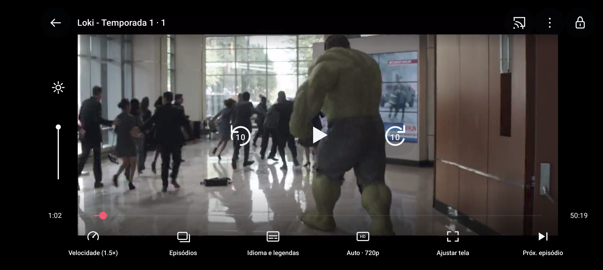

# Kinexo — validação do APK refinado

APK: `kinexo-refino-experimental-debug.apk`, **24,526,086 bytes**, SHA-256 `a5ba39cefaf21464ff359d10a6ce570d0622137f8fb7bc87529f9a2db88ce186`. Mesma árvore `movie-evolucao`, mesmo pacote do Movie. Build offline: 21 Java ativos + 19.018 Smali → nove DEX; nenhuma entrada APK/DEX pronta. Fontes C/C++ dos seis nativos continuam indisponíveis.

## Testes realizados

| Ensaio | Verificações aprovadas | Evidência |
|---|---:|---|
| Home/catálogo/streaming, perfis, backup, player/gestos, qualidade e retomada | 75 | [core.txt](core.txt) |
| HLS público multifaixa: manual, Auto adaptativo, fallback, áudio/legendas | 10 | [fixture.txt](fixture.txt) |
| Troca real de temporada e retorno de outra tela ao mesmo player | 10 | [seasons.txt](seasons.txt) |
| Tela 360×640 dp, fonte 130%, animações desativadas, navegação/Cast/banner | 12 | [layout.txt](layout.txt) |
| Exportação + reinstalação limpa + restauração | 1 + 7 | [clean-restore.json](clean-restore.json), [backup-restore.txt](backup-restore.txt) |

Todos os ensaios atuam no AVD `Movie_Observe_API37` / `emulator-5556`. Nenhuma alteração no telefone físico. As verificações incluem quadros efetivamente renderizados, não apenas estado READY ou presença de botões. A fonte real testada do catálogo ofereceu **uma faixa 720p**. O teste adaptativo separado usou as faixas reais 144p/240p/360p/480p/576p de um HLS público do Google; não acrescenta esse conteúdo ao catálogo.

[Auditoria do APK](apk-audit.json): sem retorno dos SDKs publicitários identificados; permissões preservadas. [Auditoria comercial](evolution-audit.json): 31 implementações ausentes e zero chamadas executáveis ao antigo gate local. [Preservação](protected-preserved.json): IdentityBinding, seis SO e asset protegido idênticos à versão funcional anterior. Isso não comprova ausência total de coleta em componentes opacos.

## Medições, com limites

| Medida | Movie v1 (2 amostras) | Kinexo final (2 amostras) |
|---|---:|---:|
| Primeiro quadro após abrir o player, ms | 4459–8037 | 2681–2854 |
| PSS do player, KiB | 124676–125723 | 124837–125103 |
| PSS da Home, KiB | 129818–130158 | 129768–130746 |
| BUFFERING nos 12 s após primeiro quadro, ms | 8257* | 5017–6429 |

*Tempo em BUFFERING foi medido somente na segunda amostra anterior. O primeiro quadro pode aparecer antes de o player começar a avançar; a janela inclui carregamento inicial e interrupções. Não é tempo até reprodução estável nem medição de FPS. Rede, cache P2P e estado do decodificador variaram. Houve espera em buffer em ambas as versões. Não há comprovação de redução sustentada de RAM ou eliminação de travamentos. Dados completos: [performance.json](performance.json).

O APK cresceu **16,384 bytes (16 KiB)**; nenhuma dependência de runtime adicionada. Foram retiradas preparações/buscas redundantes e corrigido o gerenciamento das telas. Não foi acrescentado cache de vídeo paralelo ou acelerador por múltiplas conexões sobre o P2P protegido.

## Capturas do Android nativo

- [Home e streamings](screens/home.png), [coleção real](screens/streaming.png), [perfis](screens/profiles.png).
- [Player com vídeo real](screens/player.png), [qualidade](screens/quality.png), [episódios](screens/episodes.png), [temporadas](screens/seasons.png), [idioma/legendas](screens/languages.png).
- [Detalhes](screens/details.png), [configurações](screens/settings.png), [descoberta de Cast](screens/cast.png).
- [Home compacta](screens/home-compact.png), [perfis compactos](screens/profiles-compact.png), [player compacto](screens/player-compact.png), [qualidade compacta](screens/quality-compact.png).

## Ainda sem validação suficiente

Transmissão até uma TV física; catálogo real em 1080p/1440p/2160p; escuta em alto-falante (AVD sem saída de áudio); bateria e desempenho em aparelhos/redes reais. Cache/transferências paralelas exigem conhecer os contratos e o comportamento do transporte protegido. Os nativos continuam binários: este projeto recompilável é híbrido Java/Smali, sem promessa de 100% dos fontes ou de rastreamento eliminado em absoluto.
